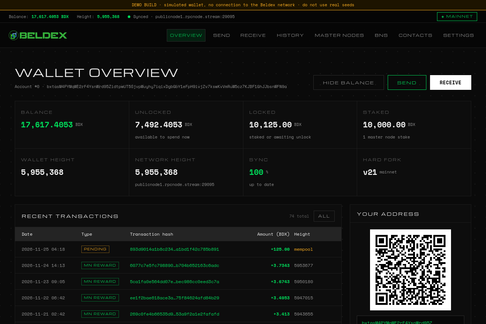
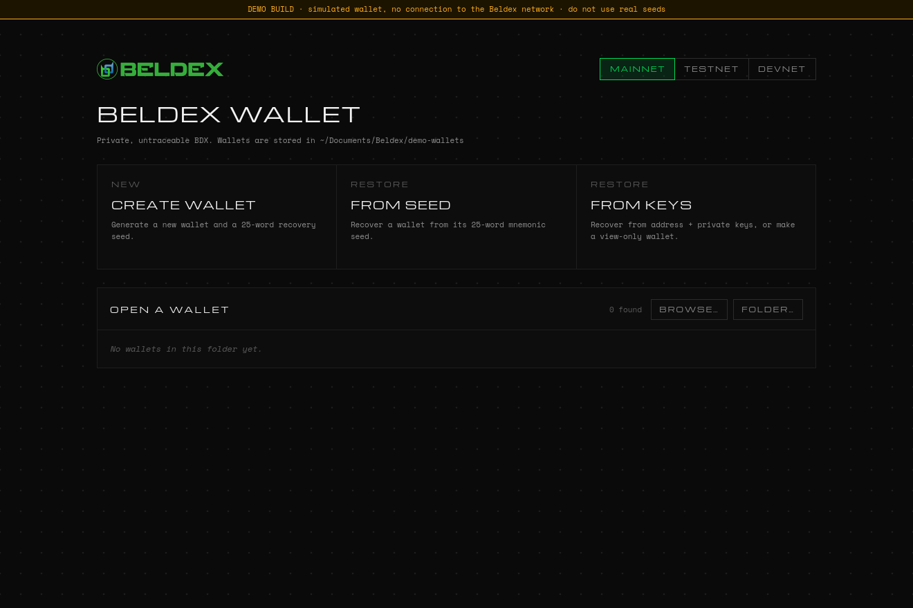
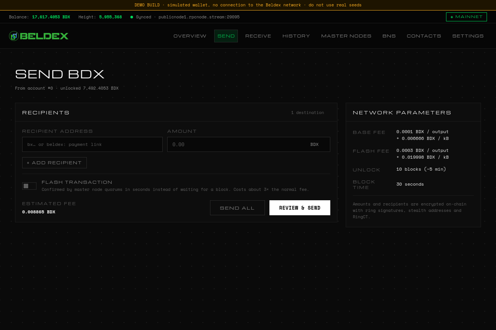
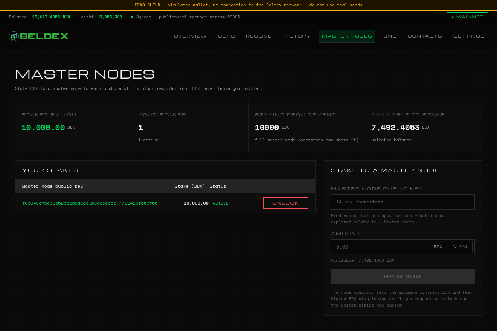
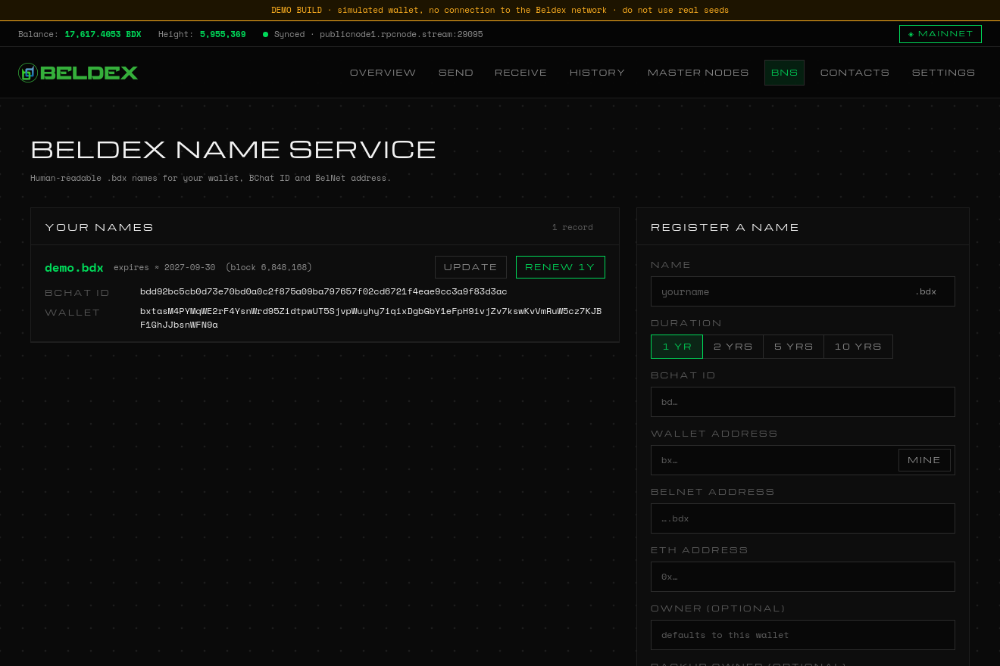
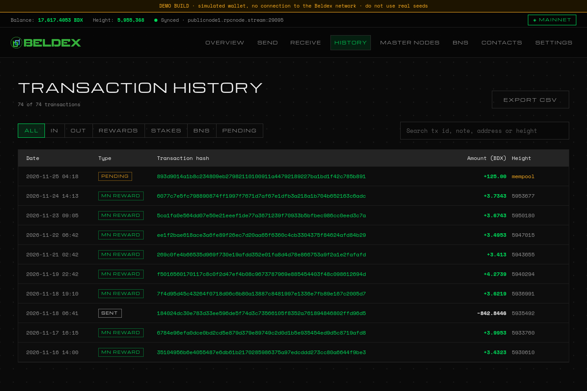
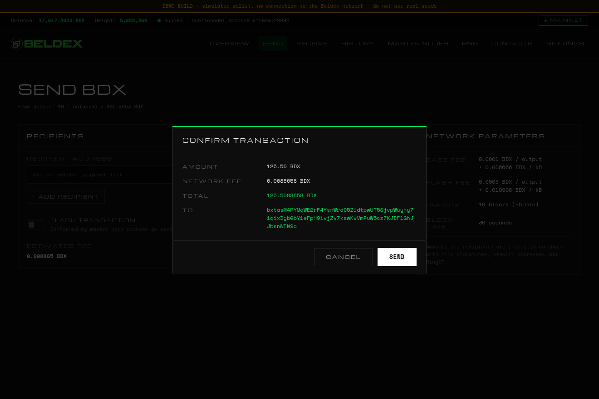
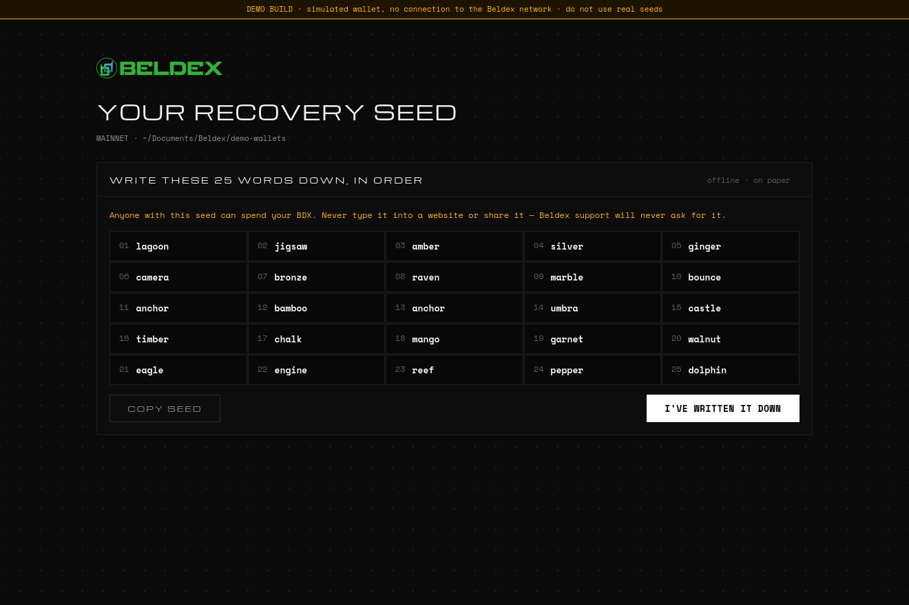
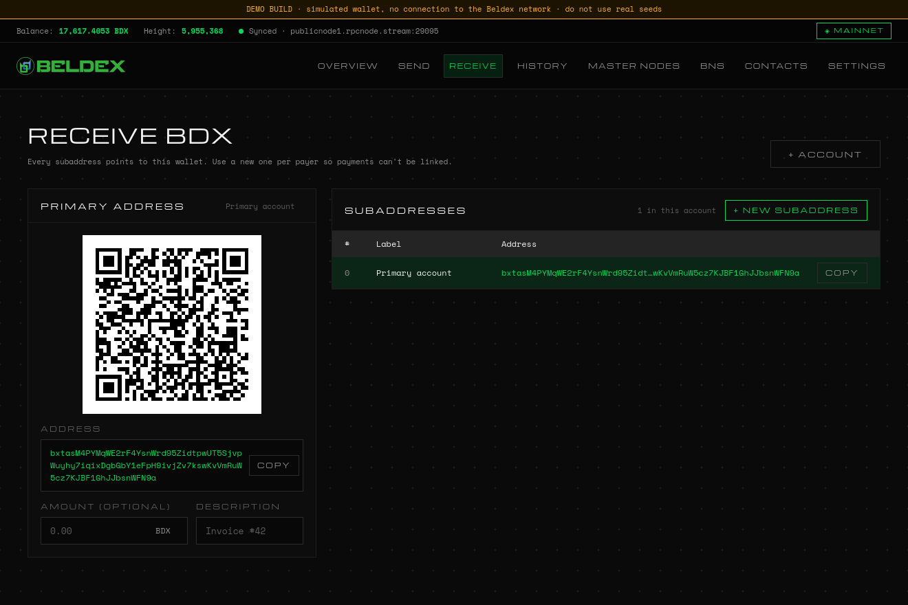
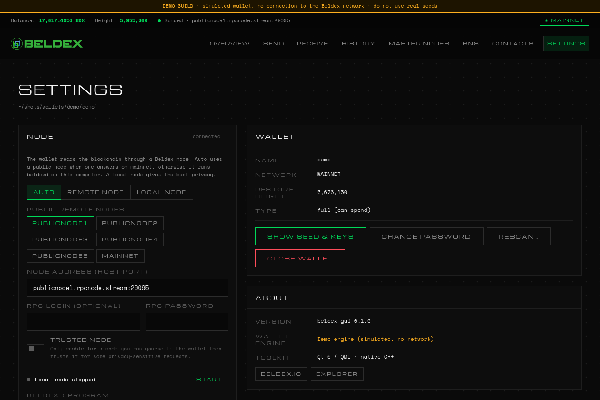

# beldex-gui

A native desktop wallet for **Beldex (BDX)**, built with **Qt 6 / QML and C++**. The architecture follows
[monero-gui](https://github.com/monero-project/monero-gui) and the visual design follows
[explorer.beldex.io](https://explorer.beldex.io).



## Why Qt and not Electron

Like monero-gui, beldex-gui **compiles Beldex core's wallet library into the app** and calls it directly.
There is no `beldex-wallet-rpc` process, no localhost RPC port, no Node.js and no Chromium.

|                       | beldex-gui (Qt/QML)                        | Electron + wallet-rpc                    |
|-----------------------|--------------------------------------------|------------------------------------------|
| Path from UI to wallet| In-process C++ calls                       | JSON-RPC over localhost                  |
| Keys live in          | The C++ wallet library                     | wallet-rpc, plus anything the JS can read|
| Dependencies          | Qt + Beldex core (git submodule)           | Hundreds of npm packages                 |
| Size / RAM            | Tens of MB                                 | 150 MB+ for Chromium alone               |

## Features

| Screen       | What it does |
|--------------|--------------|
| Wizard       | Create a wallet (25-word seed backup plus a 3-word check), restore from seed (with restore height or date, optional seed offset), restore from keys / view-only, open from a folder or file. Mainnet, testnet or devnet. |
| Overview     | Explorer-style stat grid (balance, unlocked, locked, staked, wallet and network height, sync %, hard fork), recent transactions, address QR code. |
| Send         | Several recipients, `beldex:` URI paste, address book picker, **Flash** transactions, fee estimate, send all, confirmation dialog. |
| Receive      | Accounts, subaddresses with editable labels, QR codes, payment links with amount and description. |
| History      | Filters (in, out, rewards, stakes, BNS, pending), search, details dialog (note, tx key, explorer link), CSV export. |
| Master Nodes | Your stakes with their status, stake to a master node, request stake unlock. |
| BNS          | Your `.bdx` names (BChat, wallet, BelNet, ETH values), register for 1/2/5/10 years, renew, update. |
| Tokens       | **Testnet only.** Privacy-token balances, send and sweep a token, create (register) a token, mint, burn, update metadata or hand over ownership, and a searchable copy of the chain's token registry (by ticker, name, id or owner). |
| Contacts     | Address book stored inside the wallet file. |
| Settings     | Node choice (public remote nodes or your own beldexd, RPC login, trusted flag), seed and keys behind a password, change password, rescan, sign/verify messages, about. |

## Architecture

```
qml/ (UI) ── Theme / App singletons, components/, pages/, Wizard.qml, WalletShell.qml
   │   binds to Q_PROPERTYs, calls Q_INVOKABLEs
src/libwalletqt/   WalletManager (QML singleton) · Wallet · PendingTransaction
src/model/         TransactionHistoryModel (filter + search + CSV)
   │   every wallet call runs on a per-wallet single-thread pool → the UI never blocks
src/engine/WalletEngine.h   bdx::IEngine / bdx::IWallet  (Qt types only)
   ├── BeldexEngine.cpp     → Beldex core  src/wallet/api/wallet2_api.h  (production)
   └── MockEngine.cpp       → simulated wallet for UI work, screenshots and CI (no network)
```

How it maps to monero-gui:

| monero-gui                         | beldex-gui |
|------------------------------------|------------|
| `monero/` submodule + `wallet_api` | `external/beldex/` submodule, `libwallet_merged.a` |
| `src/libwalletqt/Wallet*.{h,cpp}`  | `src/libwalletqt/` (wraps `bdx::IWallet`, not the core header directly) |
| `src/model/TransactionHistory*`    | `src/model/TransactionHistoryModel` |
| `QRCodeImageProvider`              | `src/qt/QRCodeImageProvider` (nayuki qrcodegen, MIT) |
| `main.qml`, `LeftPanel`, `pages/`, `wizard/` | `qml/Main.qml`, `WalletShell.qml` (top nav, like the explorer), `qml/pages/`, `qml/Wizard.qml` |
| *(none)*                           | Master node staking, BNS and Flash, which are Beldex-only |

The `bdx::IWallet` layer exists so the whole UI builds and runs **without** compiling Beldex core
(`-DBELDEX_GUI_MOCK=ON`), and so any change in Beldex's API touches one file.

## Design

Tokens come from the explorer's `style.css` `:root` and live in [`qml/theme/Theme.qml`](qml/theme/Theme.qml):
background `#0a0a0a` with a 30 px dot grid, panels `#0d0d0d`, borders `#1e1e1e` / `#2c2c2c`,
accent green `#00d959`. Headings use **Michroma** and values use **Space Mono**; both are OFL and bundled in `fonts/`.
Corners are square, the primary button is the explorer's white SEARCH block, and outlined chips mark navigation and network.

| Wizard | Send | Master nodes |
|---|---|---|
|  |  |  |
| **BNS** | **History** | **Confirm** |
|  |  |  |
| **Seed backup** | **Receive** | **Settings** |
|  |  |  |

## Nodes: remote, local, auto

Settings › Node sets one mode per network:

| Mode   | What it does |
|--------|--------------|
| Auto   | Tries the configured node, then the public list. The first one that answers **on the right network** is used. If none answers, it starts a local `beldexd` and connects to it. Default for every network. |
| Remote | Uses only the given node (with optional RPC login). |
| Local  | Runs `beldexd` on this computer (built by `scripts/build-beldex-core.sh`), shows its sync progress, connects the wallet to `127.0.0.1:19091 / 29091 / 39091`, and stops it when the app quits. An already-running beldexd on that port is used as-is. |

Wallets always open on their own network: if the selector says mainnet but the file is a testnet wallet, the app retries
on the right network. Sending waits until a local node has caught up with the network. The node's log goes to
`~/.local/share/Beldex/beldex-gui/beldexd-<network>.log`.

The wizard offers mainnet, testnet and devnet. Every network defaults to Auto: the configured node, then the public
ones, then a local node. `BELDEX_GUI_MAINNET_ONLY=1` hides testnet and devnet.

| Network | Public node(s) |
|---------|----------------|
| Mainnet | `publicnode1`–`publicnode5.rpcnode.stream:29095` |
| Testnet | `209.126.86.93:29091` (testnet, hard fork v22) |
| Devnet  | none: runs a local node |

**One wallet on several networks.** Click the network badge (◈ MAINNET ▾) in the status bar, or Settings › Wallet ›
Switch network. A wallet file belongs to one network, so the app keeps the same seed as a separate wallet next to the
original (`<name>-testnet`, `<name>-devnet`; a testnet-born wallet's mainnet copy is `<name>-mainnet`). The first
switch creates that copy from the seed and asks where to start scanning: now (a new account on that network), the full
history, or a block. Later switches just save one and open the other. A testnet copy's first sync downloads the whole
testnet block list (core has no testnet checkpoints to skip it), which takes several minutes.

**Testnet status (checked 2026-11-25).** Testnet is on hard fork **v22**, whose blocks carry privacy-token
transactions. Released Beldex core can't read those, so `external/beldex` tracks core's `feature-privacy-token` branch
(what the public testnet node runs). Mainnet behaves as before on it. A local testnet node built from this core also needs
a reachable peer under Settings › Node › Testnet peers.

**Privacy tokens (testnet only).** Testnet wallets get a Tokens tab and an asset picker on Send; mainnet wallets show
neither, because mainnet has no tokens yet. It covers what the CLI's token commands do: `balance` (token balances per
account), `transfer <token_id:address>`, `sweep_all bdx:/token_id:/address`, `register_privacy_token`, `mint_token`,
`burn_token`, `update_token` (metadata and owner) and `tokens_by_owner`. Token amounts use each token's own decimals; the
network fee is always BDX, and core adds protocol fees on testnet: registering costs 100 BDX (50 burned, 50 to
governance) and locks another 100 BDX of the wallet as collateral for 518,400 blocks (about 6 months), minting burns 5 BDX, updating 1 BDX, burning is free. History shows token transfers in their own units with the token id in the details. Core's
`TokensByOwner` asks the node about every token one at a time (about 4 minutes for the ~670 testnet tokens, with the
wallet blocked), so the app reads the registry itself, six requests at a time (about a minute), keeps a copy in the app
data folder, re-reads it once a day, and filters it by owner locally.

## Building

You need Qt **6.8+** (Core, Gui, Qml, Quick, QuickControls2, Concurrent, Svg), CMake 3.21+ and a C++17 compiler.
To install Qt without root:

```bash
pip install aqtinstall && aqt install-qt linux desktop 6.8.3 linux_gcc_64 --outputdir ~/Qt
```

### 1. Demo build (UI only, simulated wallet)

```bash
cmake -S . -B build-demo -G Ninja -DBELDEX_GUI_MOCK=ON -DCMAKE_PREFIX_PATH=$HOME/Qt/6.8.3/gcc_64
cmake --build build-demo
./build-demo/beldex-wallet-gui
```

A demo build shows an amber **DEMO BUILD** banner and never touches the network. It still compiles
`BeldexEngine.cpp` against Beldex's real `wallet2_api.h`, so API drift is caught.

### 2. Real build (Beldex core)

```bash
sudo apt install build-essential cmake git autoconf automake libtool pkg-config gperf   # Linux host tools
# builds libwallet_merged.a (linked into the GUI) and bin/beldexd (the local node)
git submodule update --init --recursive
./scripts/build-beldex-core.sh            # builds external/beldex → libwallet_merged.a
cmake -S . -B build -G Ninja -DCMAKE_PREFIX_PATH=$HOME/Qt/6.8.3/gcc_64
cmake --build build
```

### Packages for Linux, Windows and macOS

```bash
./scripts/build-beldex-core.sh                         # once per machine: wallet library + beldexd
QT_DIR=~/Qt/6.8.3/gcc_64 ./scripts/package.sh          # → dist/
```

| OS | Packages | Notes |
|----|----------|-------|
| Linux x86_64 / arm64 | `.AppImage` (any distro), `.deb`, `.rpm`, `.tar.gz` | Self-contained, with Qt and beldexd bundled. `.deb`/`.rpm` install to `/opt/beldex-wallet` and link the launcher, desktop entry and icons into `/usr`. |
| Windows x64 | installer `.exe` (NSIS), portable `.zip` | Build in an MSYS2 **MINGW64** shell (Beldex core's Windows toolchain). Start menu and desktop shortcuts, uninstaller. |
| macOS arm64 / x86_64 | `.dmg` with `Beldex Wallet.app` | beldexd sits inside the bundle. Not signed or notarized yet. |

App icons for every platform are in `packaging/icons/`: PNG 16–1024, `.ico` and `.icns`. Linux gets a `.desktop`
entry (with the `beldex:` link type) and AppStream metadata. Windows gets icon and version resources. macOS gets an
`Info.plist` that registers `beldex:` links.

`.github/workflows/build.yml` builds, tests and packages all of these on GitHub Actions. Linux builds on Ubuntu 22.04
(glibc 2.35), so the packages run on most current distributions. Pushing a `v*` tag publishes a release with every package.

### Engine smoke test

Runs against whichever engine is linked: create, reopen, wrong password, restore from seed, plus an optional node check.

```bash
cmake --build build --target engine_smoke && ./build/engine_smoke publicnode1.rpcnode.stream:29095
```

### Screenshot tour / end-to-end test

This renders every screen offscreen and exits. In a demo build it uses the simulated wallet. In a real build
it creates a fresh mainnet wallet through the GUI layer, connects to the configured node, waits for sync,
then checks the address, connection, height and subaddresses. It exits non-zero if any check fails.

```bash
QT_QPA_PLATFORM=offscreen BELDEX_GUI_SHOTS=shots ./build-demo/beldex-wallet-gui   # demo
QT_QPA_PLATFORM=offscreen BELDEX_GUI_SHOTS=shots ./build/beldex-wallet-gui        # real Beldex core
```

Local node checks: `BELDEX_GUI_TOUR=testnet-local`, `devnet-local` and `mainnet-local` start beldexd in a throwaway
folder, connect a new wallet to it, and check that quitting stops it.

Privacy tokens: `BELDEX_GUI_TOUR=tokens` in a demo build runs every token action (balances, send, sweep, register, mint,
burn, update, owner lookup, history units) and checks a mainnet wallet shows none; CI runs it. `BELDEX_GUI_TOUR=tokens-real`
in a real build syncs a new testnet wallet, reads the live registry and calls core's token functions up to (not
including) broadcasting. `BELDEX_GUI_TOUR=tokens-chain` makes real, funded token transactions on a private testnet:
wallet A (`BELDEX_GUI_TOUR_SEED_A`, 250+ unlocked BDX) registers a token, mints, sends some to wallet B
(`BELDEX_GUI_TOUR_SEED_B`), burns, updates the metadata, sweeps the rest to B and hands B ownership; then B must hold the
tokens and be able to mint. Point it at the node with `BELDEX_GUI_TOUR_NODE` (default `127.0.0.1:28081`; something must be
mining) and set `XDG_CONFIG_HOME`/`XDG_DATA_HOME` to a scratch folder, since it changes the testnet node setting.

Other real-build checks: `BELDEX_GUI_TOUR=midscan` (seed, subaddress and close during a scan, then resume),
`BELDEX_GUI_TOUR=resume` (restored wallet closed before its first scan; rescan from height).

To watch a full restore sync (restore from seed at height 0, poll until Synced), run
`BELDEX_GUI_TOUR=restore BELDEX_GUI_TOUR_MINUTES=60` with the real build. Set `BELDEX_GUI_LOG_LEVEL=1` (0–4) for more core logging.

Beldex core writes its log to `~/.local/share/Beldex/beldex-gui/beldex-wallet-gui.log` (shown under Settings › About),
not to the terminal.

## Notes for Beldex core

beldex-gui carries a few small patches to Beldex core in `scripts/patches/`. `build-beldex-core.sh` applies them
automatically, and they should go upstream:

- **`0005`: wallet_api history doesn't say which token moved.** `TransactionInfo` has no token id, so a token transfer
  looked like a BDX amount. The patch adds `tokenId()` and `payType()` (and a token id per transfer), filled from
  `wallet2::make_transfer_view` exactly as the CLI's `show_transfers` does.

- **`0006`: history refresh and the scan could deadlock.** `WalletImpl::doRefresh` holds the wallet (refresh) lock and
  then reads the history size (history lock); `TransactionHistoryImpl::refresh()` took the history lock first and then the
  wallet lock. A history reload from another thread that raced a scan froze both for good (the wallet stopped syncing).
  On a busy chain it happened right after sending a transaction. The patch takes the wallet lock first in `refresh()`.

- **`WalletImpl::stop()` couldn't stop a scan.** It took the refresh lock that the scan holds for its whole duration,
  then set `wallet2`'s atomic stop flag, so it only returned once the scan had finished. The patch sets the flag without
  the lock (in `stop()` and `LOCK_REFRESH`). With it, closing a wallet mid-scan takes under a second and keeps the
  progress so far, and the GUI can pause a scan for seed display, labels, contacts and similar actions, then resume it.
- **wallet_api calls block during a scan.** While the refresh thread syncs, calls that need the node (`connected()`,
  `daemonBlockChainHeight()`, fee estimates, `listCurrentStakes()` …) wait on wallet2's RPC lock until the scan ends,
  which can take many minutes on a restore. `blockChainHeight()` is also cached and doesn't move until then. beldex-gui
  works around this: it reads node state before starting the refresh, uses `isRefreshing()` to skip node calls while
  scanning, and takes live progress from `WalletListener::newBlock(height)`.
- **A restored wallet closed before its first scan loses its restore height.** `WalletImpl::isNewWallet()` treats any
  never-scanned wallet as new unless `m_recoveringFromSeed` is set, and that flag is never saved to disk. On reopen,
  `doInit` fast-forwards it to the current block and skips its whole history. beldex-gui stores the restore height
  as a cache attribute and resumes the restore on reopen (`BELDEX_GUI_TOUR=resume` tests it). Settings › Rescan…
  repairs wallets that were already affected.
- **Devnet can't start.** Its genesis block is version 1, but `devnet_hard_forks` begins with v7 at height 0, so
  `beldexd --devnet` fails with "Failed to add genesis block to blockchain". The app shows that reason in the status bar.
  The fix belongs upstream (begin the devnet table with `hf1` at height 1, like mainnet and testnet).
- **Some wallet_api methods let exceptions escape**, for example `tools::error::no_connection_to_daemon` from
  `estimateTransactionFee`, `hardForkVersion` and `listCurrentStakes`. beldex-gui catches them around every call.

- `Wallet::StakeUnlockResult` in `wallet2_api.h` has **no virtual destructor**, but `canRequestStakeUnlock` /
  `requestStakeUnlock` return heap objects through the base pointer. Deleting them is undefined behaviour, so
  `BeldexEngine` leaks them on purpose. Fix upstream: `virtual ~StakeUnlockResult() = default;`.
- Remote nodes come from the Beldex Electron wallet. `publicnode1-5.rpcnode.stream:29095` answer RPC and are the defaults;
  `mainnet.beldex.io:29095` did not respond when tested (2026-11-24) and is listed last.

## Not done yet

- Code signing: Windows Authenticode, macOS signing and notarization. Unsigned builds show OS warnings on first launch.
- Opening `beldex:` links from the browser into the Send page. The link type is registered on Linux and macOS, but the
  app doesn't read the link yet.

- Ledger / hardware wallets, multisig, QR scanning from the camera, offline (cold) signing UI
- Translations, packaging (AppImage/DMG/MSI), reproducible Docker/Guix builds, signed update checks

## License

BSD-3-Clause. Michroma and Space Mono are under the SIL Open Font License (see `fonts/`).
